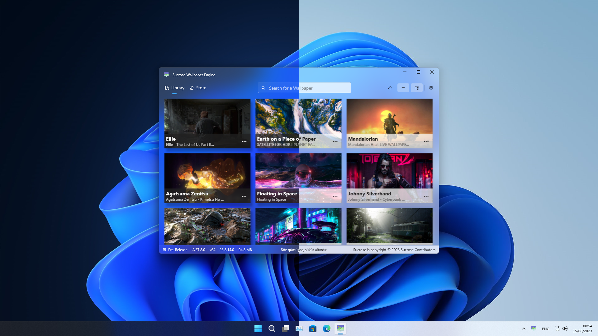
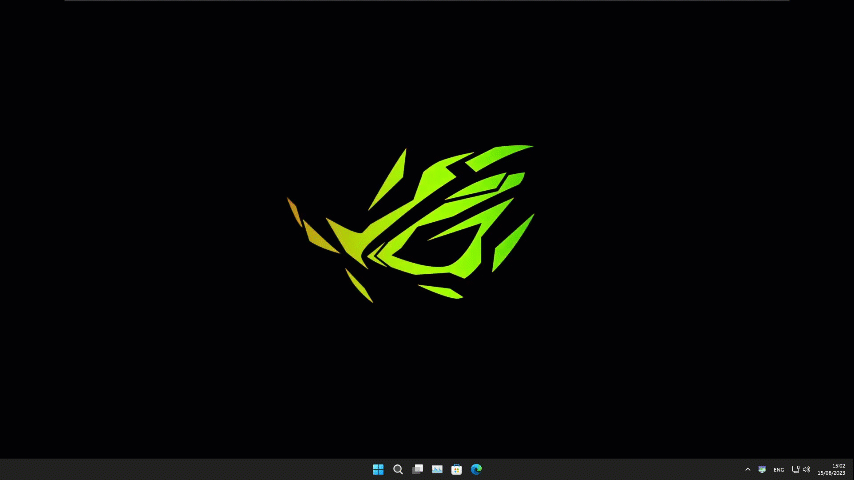
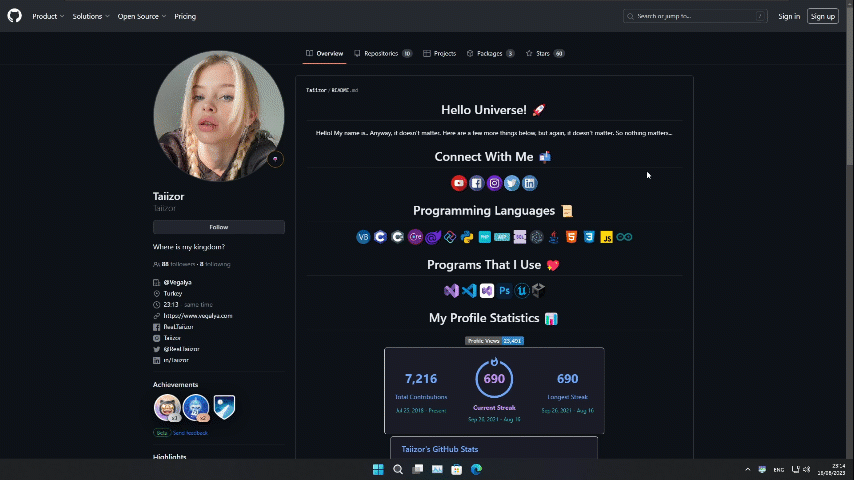
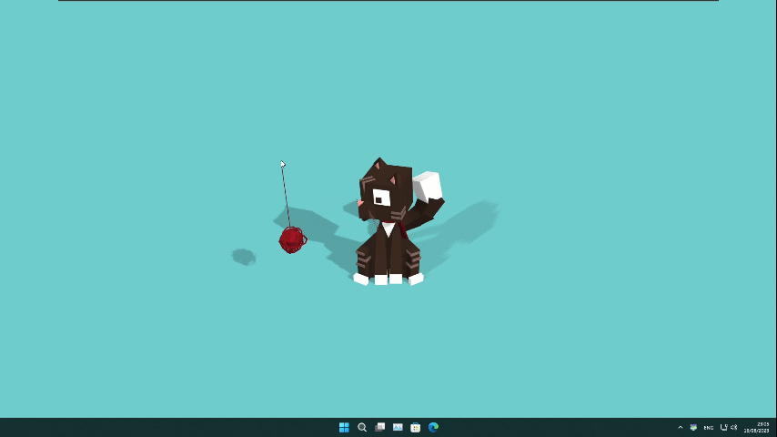
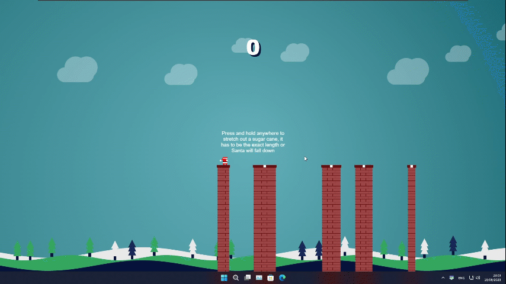

  <h4><a href="README.md">英語 (English)</a> | <a href="README.tr-TR.md">トルコ語 (Türkçe)</a> | <a href="README.zh-CN.md">中国語 (中文)</a> | 日本語</h4>
   
   

  
  <h2>Sucrose Wallpaper Engine (Sucrose 壁紙エンジン)</h2>

  
    <b>Sucrose</b>は、デスクトップで多様なインタラクティブな壁紙を実現する多機能な壁紙エンジンです。ライトテーマとダークテーマのオプションがあり、個人の好みに合わせた外観を選ぶことができます。シンプルに、または詳細に独自の壁紙を作成でき、複数の画面とすべての画面解像度をサポートしているため、さまざまなディスプレイ構成でシームレスな体験が可能です。
  
   
   
  
    完全にオープンソースで無料の<b>Sucrose</b>は、どの機能に対しても支払いを必要とせず、ユーザーに完全なアクセスを提供します。<b>Sucrose Audio API</b>を使用してメディア応答型の壁紙を作成したり、<b>Sucrose System API</b>を使用してシステム状態インジケーターを備えた壁紙をデザインしたりできます。さらに、<b>CefSharp</b>と<b>WebView</b>を使用して、任意のウェブサイトを壁紙として使用することもできます。
  
   
   
  
    <b>Sucrose</b>では、独自のカスタム壁紙を作成し、友人や<b>Sucroseコミュニティ</b>と共有することができます。ユーザーが提供する壁紙を<b>Sucroseストア</b>から直接探索してダウンロードすることもできます。
  
   
   
  
    パフォーマンスの面では、CPUとGPUの使用を最適化してスムーズなパフォーマンスを確保します。フルスクリーンのアプリケーション/ゲームが実行されている場合、リソースを節約するために自動的に壁紙を一時停止し、ラップトップなどでバッテリー電源で実行されている場合に壁紙を一時停止する省電力モードも備えています。
  
   
   
  
    <b>Sucrose</b>は、デスクトップをパーソナライズしてアニメーション化するための強力なツールです。ユーザーが創造性を表現し、デスクトップ体験を完全にカスタマイズすることを可能にします。
  

<h4 align="center">
  <a href="https://github.com/Taiizor/Sucrose/issues">問題</a> ●
  <a href="https://github.com/Taiizor/Sucrose/discussions">ディスカッション</a> ●
  <a href="https://github.com/Taiizor/Sucrose/wiki">ドキュメント</a> ●
  <a href="https://github.com/Taiizor/Store">ストア</a> ●
  <a href="https://www.youtube.com/playlist?list=PLPU_0X-WyJi6VbMMaTOTXuU6EVGiy_Kqx">機能</a> ●
  <a href="https://www.youtube.com/playlist?list=PLPU_0X-WyJi7WSUHItUfxbr71ORthre19">プレビュー</a> ●
  <a href="https://www.youtube.com/playlist?list=PLPU_0X-WyJi5eNcBrRkEg9uoGX0R1Z5SY">チュートリアル</a> ●
  <a href="https://discord.gg/nxG977byXb">Discord</a>
</h4>

  

  
  
  
  
  
  

  
  
  
  

  
  

  
  

  
  

  <h2>機能</h2>
  

    <em>少々お待ちください。プレビューGIFクリップの読み込みに時間がかかる場合があります。</em>
  

  <h4>壁紙のバリエーション</h4>
  <table align="center" style="margin:auto">
    <tr>
      <th>壁紙タイプ</th>
      <th>例</th>
      <th>インタラクティブ</th>
      <th>解像度</th>
      <th>パフォーマンス</th>
    </tr>
    <tr align="center">
      <td>Gif</td>
      <td>
        
         <a href="https://github.com/Taiizor/Store/blob/develop/src/Colorful/Asus ROG-1">Asus ROG</a> 壁紙
      </td>
      <td>いいえ</td>
      <td>可変</td>
      <td>固定</td>
    </tr>
    <tr align="center">
      <td>Url</td>
      <td>
        
         <a href="https://github.com/Taiizor/Store/blob/develop/src/Dynamic/The 25th Hour-1">The 25th Hour</a> 壁紙
      </td>
      <td>はい</td>
      <td>固定</td>
      <td>可変</td>
    </tr>
    <tr align="center">
      <td>Web</td>
      <td>
        
         <a href="https://github.com/Taiizor/Store/blob/develop/src/Animals/Cat vs Ball of Wool-1">Cat vs Ball of Wool</a> 壁紙
      </td>
      <td>はい</td>
      <td>固定</td>
      <td>可変</td>
    </tr>
    <tr align="center">
      <td>Video</td>
      <td>
        
         <a href="https://github.com/Taiizor/Store/blob/develop/src/Vehicles/Batmobile Pursuit-1">Batmobile Pursuit</a> 壁紙
      </td>
      <td>いいえ</td>
      <td>可変</td>
      <td>固定</td>
    </tr>
    <tr align="center">
      <td>YouTube</td>
      <td>
	    
         <a href="https://github.com/Taiizor/Store/blob/develop/src/Space/Floating in Space-1">Floating in Space</a> 壁紙
      </td>
      <td>いいえ</td>
      <td>固定</td>
      <td>可変</td>
    </tr>
    <tr align="center">
      <td>Application</td>
      <td>
        
         <a href="https://github.com/BayatGames/RedRunner">Red Runner</a> 壁紙
      </td>
      <td>はい</td>
      <td>固定</td>
      <td>可変</td>
    </tr>
  </table>

  

    <h4>その他の機能</h4>
    
● ライトテーマとダークテーマの機能。

    
● シンプルまたは詳細に独自の壁紙を作成。

    
● 複数の画面とすべての画面解像度をサポート。

    
● システムパフォーマンスに基づいて壁紙の動作を決定。

    
● 様々な壁紙エンジンとプラグインを自由にカスタマイズ。

    
● Sucrose Audio APIを使用してメディア応答型の壁紙を作成。

    
● Sucrose System APIを使用してシステム状態を表示する壁紙を作成。

    
● 指定した時間間隔またはランダムに異なる壁紙間を自動的に切り替え。

    
● 完全にオープンソースで無料、どの機能にも支払いは必要ありません。

    
● CefSharpとWebViewを使用して、任意のウェブサイトを壁紙として使用可能。

  

  

    <h4>壁紙の作成と共有</h4>
    
● 独自のカスタム壁紙を作成し、友人やSucroseコミュニティと共有できます。

    
● ユーザー提出の壁紙ストアを探索し、Sucroseストアから直接ダウンロードできます。

  

  

    <h4>パフォーマンス</h4>
    
● スムーズなパフォーマンスのためにCPUとGPUの使用を最適化。

    
● バッテリー駆動時（ラップトップなど）に壁紙を一時停止する省電力モード。

    
● リソースを節約するためにフルスクリーンのアプリケーション/ゲーム実行時に壁紙を自動一時停止。

  

  <h2>ダウンロード</h2>

  <strong>Microsoft Store</strong>

  <table align="center" style="margin:auto">
    <tr>
      <th>.NET</th>
      <th>x64</th>
      <th>x86</th>
      <th>ARM64</th>
    </tr>
    <tr align="center">
      <td><a href="https://dotnet.microsoft.com/ja-jp/download/dotnet-framework/net48">.NET Framework 4.8</a></td>
      <td>
        
      </td>
      <td>
        
      </td>
      <td>
        
      </td>
    </tr>
  </table>

  

  <strong>GitHub</strong>

  <table align="center" style="margin:auto">
    <tr>
      <th>.NET</th>
      <th>x64</th>
      <th>x86</th>
      <th>ARM64</th>
    </tr>
    <tr align="center">
      <td><a href="https://dotnet.microsoft.com/ja-jp/download/dotnet-framework/net48">.NET Framework 4.8</a></td>
      <td>
        
      </td>
      <td>
        
      </td>
      <td>
        
      </td>
    </tr>
  </table>

  <!--

  <strong>情報</strong>

  <table align="center" style="margin:auto">
    <tr align="center">
      <td>
        
<strong>.NET Framework</strong>: .NET Frameworkは、クライアントとサーバーアプリケーションを構築するためのWindows専用の.NETバージョンです。

      </td>
    </tr>
    <tr align="center">
      <td>
        
<strong>.NET</strong>: .NETは、多くの異なるタイプのアプリケーションを構築するための無料のクロスプラットフォームでオープンソースの開発者プラットフォームです。

      </td>
    </tr>
  </table>-->

  <h2>サポート</h2>
  
Sucroseへのあらゆる貢献に感謝します。プロジェクトをサポートする方法は以下の通りです：

  

    <h4>開発者</h4>
    
● コードベースに貢献し、Sucroseの改善を支援する。

  

  

    <h4>デザイナー</h4>
    
● より良いユーザーエクスペリエンスのためにSucroseのUI/UXを改善する。

  

  

    <h4>ローカライゼーション</h4>
    
● より広い視聴者にリーチするために、Sucroseをより多くの言語に翻訳する支援をする。

  

  

    <h4>フィードバックとバグレポート</h4>
    
● Sucroseの改善に役立つ新機能の提案やバグの報告。

  

  

    <h4>広めてください</h4>
    
● このリポジトリにスターを付け、ソーシャルメディアでSucroseの体験を共有する。

  

