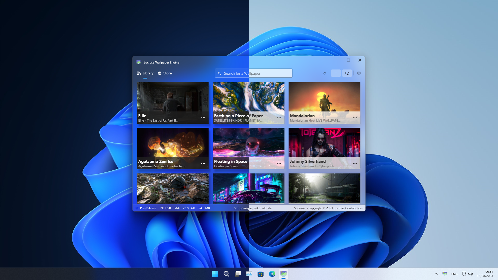
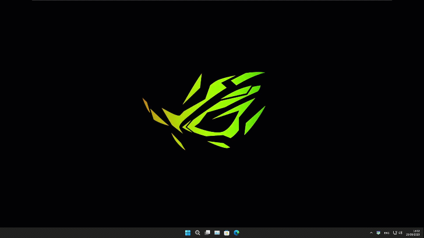
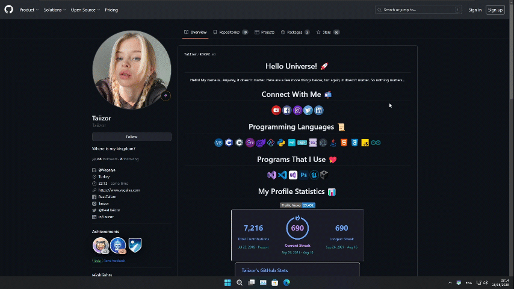
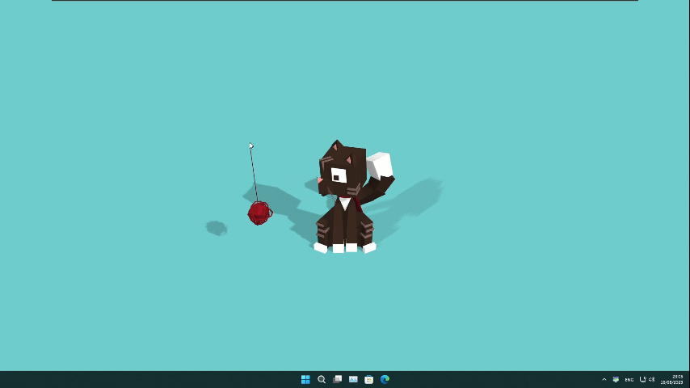
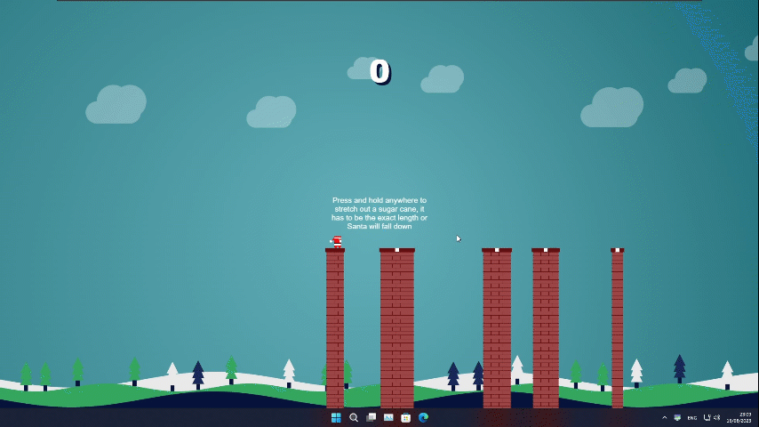

  <h4>English | <a href="README.tr-TR.md">Turkish (Türkçe)</a> | <a href="README.zh-CN.md">Chinese (中文)</a> | <a href="README.ja-JP.md">Japanese (日本語)</a></h4>
   
   

  
  <h2>Sucrose Wallpaper Engine</h2>

  
    <b>Sucrose</b> is a versatile wallpaper engine that brings a wide range of interactive wallpapers to life on your desktop. With light and dark theme options, you can choose the appearance that suits your personal preferences. You can create your own wallpapers simply or in detail, and it supports multiple screens and all screen resolutions for a seamless experience across various display configurations.
  
   
   
  
    Completely open-source and free, <b>Sucrose</b> doesn't require any payments for any features, granting users full access. You can create media-responsive wallpapers using the <b>Sucrose Audio API</b> and design wallpapers with system status indicators using the <b>Sucrose System API</b>. Additionally, you can use any website as a wallpaper using <b>CefSharp</b> and <b>WebView</b>.
  
   
   
  
    <b>Sucrose</b> allows you to create your own custom wallpapers and share them with friends or the <b>Sucrose Community</b>. You can explore and download wallpapers offered by users directly from the <b>Sucrose Store</b>.
  
   
   
  
    In terms of performance, it ensures smooth performance by optimizing CPU and GPU usage. It automatically pauses wallpapers when fullscreen applications/games are running to conserve resources, and it has a power-saving mode that pauses wallpapers when running on battery power, such as on laptops.
  
   
   
  
    <b>Sucrose</b> is a powerful tool for personalizing and animating your desktop. It enables users to express their creativity and fully customize their desktop experiences.
  

<h4 align="center">
  <a href="https://github.com/Taiizor/Sucrose/issues">Issues</a> ●
  <a href="https://github.com/Taiizor/Sucrose/discussions">Discussions</a> ●
  <a href="https://github.com/Taiizor/Sucrose/wiki">Documentation</a> ●
  <a href="https://github.com/Taiizor/Store">Store</a> ●
  <a href="https://www.youtube.com/playlist?list=PLPU_0X-WyJi6VbMMaTOTXuU6EVGiy_Kqx">Feature</a> ●
  <a href="https://www.youtube.com/playlist?list=PLPU_0X-WyJi7WSUHItUfxbr71ORthre19">Preview</a> ●
  <a href="https://www.youtube.com/playlist?list=PLPU_0X-WyJi5eNcBrRkEg9uoGX0R1Z5SY">Tutorial</a> ●
  <a href="https://discord.gg/nxG977byXb">Discord</a>
</h4>

  

  
  
  
  
  
  

  
  
  
  

  
  

  
  

  
  

  <h2>Features</h2>
  

    <em>Take a moment, preview GIF clips may take some time to load.</em>
  

  <h4>Wallpaper Varieties</h4>
  <table align="center" style="margin:auto">
    <tr>
      <th>Wallpaper Type</th>
      <th>Example</th>
      <th>Interactive</th>
      <th>Resolution</th>
      <th>Performance</th>
    </tr>
    <tr align="center">
      <td>Gif</td>
      <td>
        
         <a href="https://github.com/Taiizor/Store/blob/develop/src/Colorful/Asus ROG-1">Asus ROG</a> Wallpaper
      </td>
      <td>No</td>
      <td>Variable</td>
      <td>Fixed</td>
    </tr>
    <tr align="center">
      <td>Url</td>
      <td>
        
         <a href="https://github.com/Taiizor/Store/blob/develop/src/Dynamic/The 25th Hour-1">The 25th Hour</a> Wallpaper
      </td>
      <td>Yes</td>
      <td>Fixed</td>
      <td>Variable</td>
    </tr>
    <tr align="center">
      <td>Web</td>
      <td>
        
         <a href="https://github.com/Taiizor/Store/blob/develop/src/Animals/Cat vs Ball of Wool-1">Cat vs Ball of Wool</a> Wallpaper
      </td>
      <td>Yes</td>
      <td>Fixed</td>
      <td>Variable</td>
    </tr>
    <tr align="center">
      <td>Video</td>
      <td>
        
         <a href="https://github.com/Taiizor/Store/blob/develop/src/Vehicles/Batmobile Pursuit-1">Batmobile Pursuit</a> Wallpaper
      </td>
      <td>No</td>
      <td>Variable</td>
      <td>Fixed</td>
    </tr>
    <tr align="center">
      <td>YouTube</td>
      <td>
	    
         <a href="https://github.com/Taiizor/Store/blob/develop/src/Space/Floating in Space-1">Floating in Space</a> Wallpaper
      </td>
      <td>No</td>
      <td>Fixed</td>
      <td>Variable</td>
    </tr>
    <tr align="center">
      <td>Application</td>
      <td>
        
         <a href="https://github.com/BayatGames/RedRunner">Red Runner</a> Wallpaper
      </td>
      <td>Yes</td>
      <td>Fixed</td>
      <td>Variable</td>
    </tr>
  </table>

  

    <h4>More Features</h4>
    
● Light and Dark theme feature.

    
● Create your own wallpapers simply or in detail.

    
● Supports multiple screens and all screen resolutions.

    
● Customize various wallpaper engines and plugins freely.

    
● Completely open-source and free, no feature requires payment.

    
● Create media-responsive wallpapers using the Sucrose Audio API.

    
● Determine the fate of the wallpaper based on system performance.

    
● Create wallpapers that display system status using the Sucrose System API.

    
● You can use any website you want as a wallpaper with CefSharp and WebView.

    
● Automatically switch between different wallpapers at specified time intervals or randomly.

  

  

    <h4>Create and Share Wallpapers</h4>
    
● Create your own custom wallpapers and share them with friends or the Sucrose community.

    
● Explore a store of user-submitted wallpapers and download them directly from the Sucrose store.

  

  

    <h4>Performance</h4>
    
● Optimize CPU and GPU usage for smooth performance.

    
● Power-saving mode to pause wallpapers when running on battery (laptops).

    
● Auto-pause wallpapers when fullscreen applications/games run to conserve resources.

  

  <h2>Download</h2>

  <strong>Microsoft Store</strong>

  <table align="center" style="margin:auto">
    <tr>
      <th>.NET</th>
      <th>x64</th>
      <th>x86</th>
      <th>ARM64</th>
    </tr>
    <tr align="center">
      <td><a href="https://dotnet.microsoft.com/en-us/download/dotnet-framework/net48">.NET Framework 4.8</a></td>
      <td>
        
      </td>
      <td>
        
      </td>
      <td>
        
      </td>
    </tr>
  </table>

  

  <strong>GitHub</strong>

  <table align="center" style="margin:auto">
    <tr>
      <th>.NET</th>
      <th>x64</th>
      <th>x86</th>
      <th>ARM64</th>
    </tr>
    <tr align="center">
      <td><a href="https://dotnet.microsoft.com/en-us/download/dotnet-framework/net48">.NET Framework 4.8</a></td>
      <td>
        
      </td>
      <td>
        
      </td>
      <td>
        
      </td>
    </tr>
  </table>

  <!--

  <strong>About</strong>

  <table align="center" style="margin:auto">
    <tr align="center">
      <td>
        
<strong>.NET Framework</strong>: .NET Framework is a Windows-only version of .NET for building client and server applications.

      </td>
    </tr>
    <tr align="center">
      <td>
        
<strong>.NET</strong>: .NET is a free, cross-platform, open-source developer platform for building many different types of applications.

      </td>
    </tr>
  </table>-->

  <h2>Support</h2>
  
We appreciate any contribution to Sucrose. Here are some ways to support the project:

  

    <h4>Developer</h4>
    
● Contribute to the codebase and help improve Sucrose.

  

  

    <h4>Designer</h4>
    
● Improve the UI/UX of Sucrose for a better user experience.

  

  

    <h4>Localization</h4>
    
● Help translate Sucrose into more languages to reach a broader audience.

  

  

    <h4>Feedback &amp; Bug Reports</h4>
    
● Suggest new features or report bugs to help us improve Sucrose.

  

  

    <h4>Spread the Word</h4>
    
● Star this repository and share your experiences with Sucrose on social media.

  

