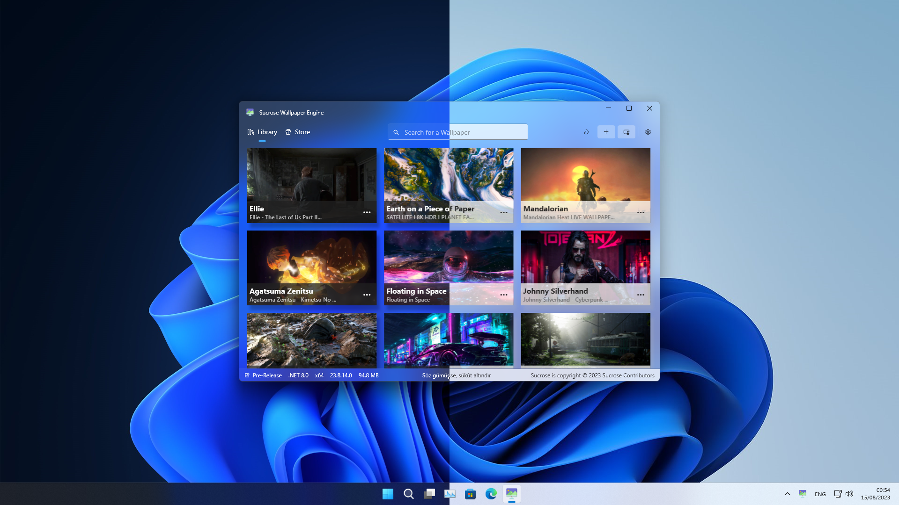
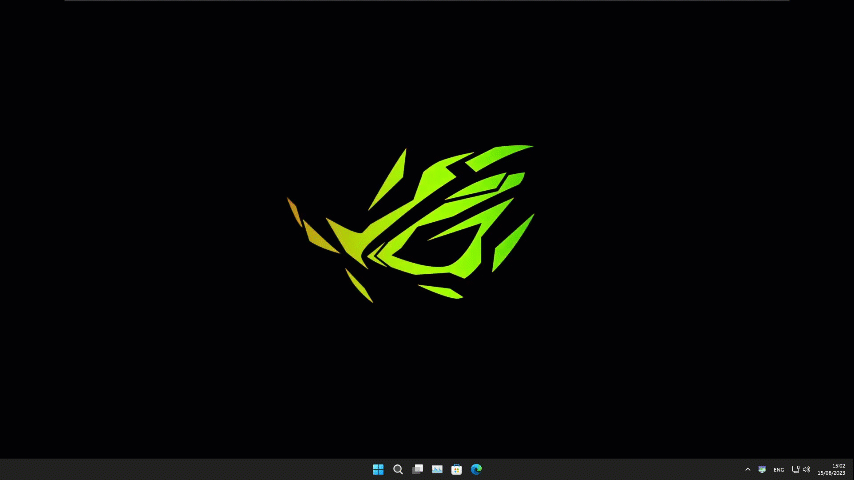
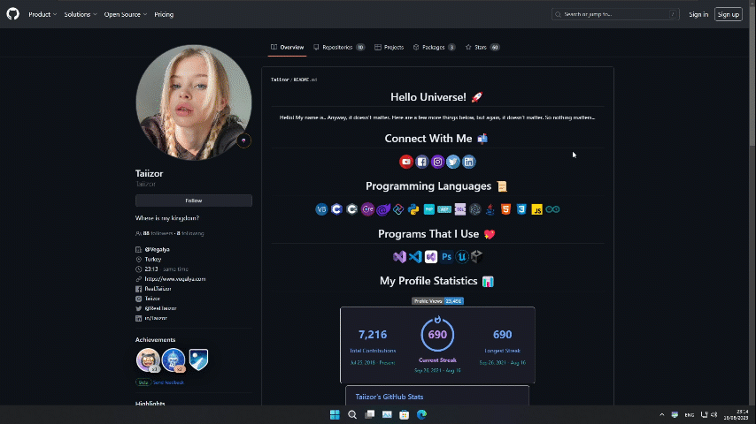
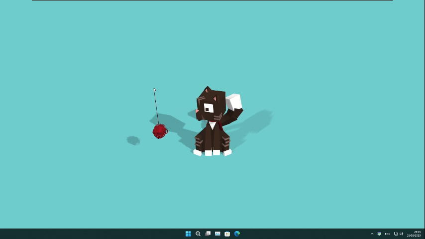
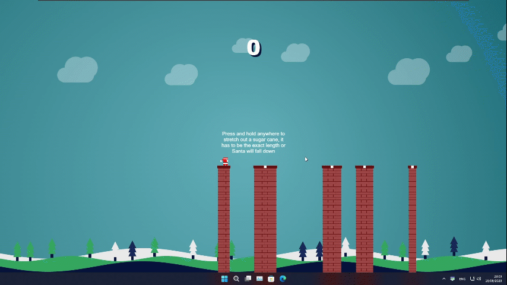
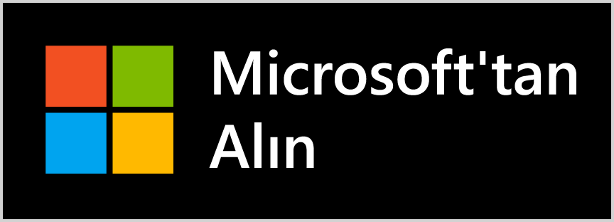

  <h4><a href="README.md">İngilizce (English)</a> | Türkçe | <a href="README.zh-CN.md">Çince (中文)</a> | <a href="README.ja-JP.md">Japonca (日本語)</a></h4>
   
   

  
  <h2>Sucrose Wallpaper Engine (Sucrose Duvar Kağıdı Motoru)</h2>

  
    <b>Sucrose</b>, masaüstünüzde çeşitli interaktif duvar kağıtlarını hayata geçiren çok yönlü bir duvar kağıdı motorudur. Açık ve koyu tema seçenekleriyle kişisel tercihlerinize uygun görünümü seçebilirsiniz. Kendi duvar kağıtlarınızı basit veya detaylı bir şekilde oluşturabilir, birden fazla ekran ve tüm ekran çözünürlüklerini destekleyerek çeşitli ekran konfigürasyonlarında sorunsuz bir deneyim elde edebilirsiniz.
  
   
   
  
    Tamamen açık kaynaklı ve ücretsiz olan <b>Sucrose</b>, hiçbir özellik için ödeme gerektirmez ve kullanıcılara tam erişim sağlar. <b>Sucrose Audio API</b> kullanarak medyaya duyarlı duvar kağıtları oluşturabilir ve <b>Sucrose System API</b> kullanarak sistem durum göstergelerine sahip duvar kağıtları tasarlayabilirsiniz. Ayrıca, <b>CefSharp</b> ve <b>WebView</b> kullanarak herhangi bir web sitesini duvar kağıdı olarak kullanabilirsiniz.
  
   
   
  
    <b>Sucrose</b>, kendi özel duvar kağıtlarınızı oluşturmanıza ve bunları arkadaşlarınızla veya <b>Sucrose Topluluğu</b> ile paylaşmanıza olanak tanır. Kullanıcılar tarafından sunulan duvar kağıtlarını doğrudan <b>Sucrose Mağazası</b>'ndan keşfedebilir ve indirebilirsiniz.
  
   
   
  
    Performans açısından, CPU ve GPU kullanımını optimize ederek sorunsuz performans sağlar. Tam ekran uygulamalar/oyunlar çalışırken kaynakları korumak için duvar kağıtlarını otomatik olarak duraklatır ve dizüstü bilgisayarlar gibi batarya gücüyle çalışırken duvar kağıtlarını duraklatmak için güç tasarrufu moduna sahiptir.
  
   
   
  
    <b>Sucrose</b>, masaüstünüzü kişiselleştirmek ve canlandırmak için güçlü bir araçtır. Kullanıcıların yaratıcılıklarını ifade etmelerini ve masaüstü deneyimlerini tamamen özelleştirmelerini sağlar.
  

<h4 align="center">
  <a href="https://github.com/Taiizor/Sucrose/issues">Sorunlar</a> ●
  <a href="https://github.com/Taiizor/Sucrose/discussions">Tartışmalar</a> ●
  <a href="https://github.com/Taiizor/Sucrose/wiki">Dokümantasyon</a> ●
  <a href="https://github.com/Taiizor/Store">Mağaza</a> ●
  <a href="https://www.youtube.com/playlist?list=PLPU_0X-WyJi6VbMMaTOTXuU6EVGiy_Kqx">Özellikler</a> ●
  <a href="https://www.youtube.com/playlist?list=PLPU_0X-WyJi7WSUHItUfxbr71ORthre19">Önizleme</a> ●
  <a href="https://www.youtube.com/playlist?list=PLPU_0X-WyJi5eNcBrRkEg9uoGX0R1Z5SY">Eğitim</a> ●
  <a href="https://discord.gg/nxG977byXb">Discord</a>
</h4>

  

  
  
  
  
  
  

  
  
  
  

  
  

  
  

  
  

  <h2>Özellikler</h2>
  

    <em>Bir dakika bekleyin, önizleme GIF'lerinin yüklenmesi biraz zaman alabilir.</em>
  

  <h4>Duvar Kağıdı Çeşitleri</h4>
  <table align="center" style="margin:auto">
    <tr>
      <th>Duvar Kağıdı Türü</th>
      <th>Örnek</th>
      <th>Etkileşimli</th>
      <th>Çözünürlük</th>
      <th>Performans</th>
    </tr>
    <tr align="center">
      <td>Gif</td>
      <td>
        
         <a href="https://github.com/Taiizor/Store/blob/develop/src/Colorful/Asus ROG-1">Asus ROG</a> Duvar Kağıdı
      </td>
      <td>Hayır</td>
      <td>Değişken</td>
      <td>Sabit</td>
    </tr>
    <tr align="center">
      <td>Url</td>
      <td>
        
         <a href="https://github.com/Taiizor/Store/blob/develop/src/Dynamic/The 25th Hour-1">The 25th Hour</a> Duvar Kağıdı
      </td>
      <td>Evet</td>
      <td>Sabit</td>
      <td>Değişken</td>
    </tr>
    <tr align="center">
      <td>Web</td>
      <td>
        
         <a href="https://github.com/Taiizor/Store/blob/develop/src/Animals/Cat vs Ball of Wool-1">Cat vs Ball of Wool</a> Duvar Kağıdı
      </td>
      <td>Evet</td>
      <td>Sabit</td>
      <td>Değişken</td>
    </tr>
    <tr align="center">
      <td>Video</td>
      <td>
        
         <a href="https://github.com/Taiizor/Store/blob/develop/src/Vehicles/Batmobile Pursuit-1">Batmobile Pursuit</a> Duvar Kağıdı
      </td>
      <td>Hayır</td>
      <td>Değişken</td>
      <td>Sabit</td>
    </tr>
    <tr align="center">
      <td>YouTube</td>
      <td>
      
         <a href="https://github.com/Taiizor/Store/blob/develop/src/Space/Floating in Space-1">Floating in Space</a> Duvar Kağıdı
      </td>
      <td>Hayır</td>
      <td>Sabit</td>
      <td>Değişken</td>
    </tr>
    <tr align="center">
      <td>Application</td>
      <td>
        
         <a href="https://github.com/BayatGames/RedRunner">Red Runner</a> Duvar Kağıdı
      </td>
      <td>Evet</td>
      <td>Sabit</td>
      <td>Değişken</td>
    </tr>
  </table>

  

    <h4>Daha Fazla Özellik</h4>
    
● Açık ve Koyu tema özelliği.

    
● Birden fazla ekranı ve tüm ekran çözünürlüklerini destekler.

    
● Kendi duvar kağıtlarınızı basit veya detaylı bir şekilde oluşturun.

    
● Çeşitli duvar kağıdı motorlarını ve eklentilerini özgürce özelleştirin.

    
● Sistem performansına bağlı olarak duvar kağıdının davranışını belirleyin.

    
● Sucrose Audio API kullanarak medyaya duyarlı duvar kağıtları oluşturun.

    
● Tamamen açık kaynaklı ve ücretsiz, hiçbir özellik için ödeme gerektirmez.

    
● Sucrose System API kullanarak sistem durumunu gösteren duvar kağıtları oluşturun.

    
● CefSharp ve WebView ile istediğiniz herhangi bir web sitesini duvar kağıdı olarak kullanabilirsiniz.

    
● Belirli zaman aralıklarında veya rastgele olarak farklı duvar kağıtları arasında otomatik geçiş yapın.

  

  

    <h4>Duvar Kağıtları Oluşturun ve Paylaşın</h4>
    
● Kendi özel duvar kağıtlarınızı oluşturun ve arkadaşlarınızla veya Sucrose topluluğuyla paylaşın.

    
● Kullanıcılar tarafından sunulan duvar kağıtlarını keşfedin ve doğrudan Sucrose mağazasından indirin.

  

  

    <h4>Performans</h4>
    
● Sorunsuz performans için CPU ve GPU kullanımını optimize edin.

    
● Pil gücüyle çalışırken (dizüstü bilgisayarlar) duvar kağıtlarını duraklatmak için güç tasarrufu modu.

    
● Kaynakları korumak için tam ekran uygulamalar/oyunlar çalışırken duvar kağıtlarını otomatik duraklatma.

  

  <h2>İndirme</h2>

  <strong>Microsoft Store</strong>

  <table align="center" style="margin:auto">
    <tr>
      <th>.NET</th>
      <th>x64</th>
      <th>x86</th>
      <th>ARM64</th>
    </tr>
    <tr align="center">
      <td><a href="https://dotnet.microsoft.com/en-us/download/dotnet-framework/net48">.NET Framework 4.8</a></td>
      <td>
        
      </td>
      <td>
        
      </td>
      <td>
        
      </td>
    </tr>
  </table>

  

  <strong>GitHub</strong>

  <table align="center" style="margin:auto">
    <tr>
      <th>.NET</th>
      <th>x64</th>
      <th>x86</th>
      <th>ARM64</th>
    </tr>
    <tr align="center">
      <td><a href="https://dotnet.microsoft.com/en-us/download/dotnet-framework/net48">.NET Framework 4.8</a></td>
      <td>
        
      </td>
      <td>
        
      </td>
      <td>
        
      </td>
    </tr>
  </table>

  <!--

  <strong>Hakkında</strong>

  <table align="center" style="margin:auto">
    <tr align="center">
      <td>
        
<strong>.NET Framework</strong>: .NET Framework, istemci ve sunucu uygulamaları oluşturmak için Windows'a özel bir .NET sürümüdür.

      </td>
    </tr>
    <tr align="center">
      <td>
        
<strong>.NET</strong>: .NET, birçok farklı uygulama türü oluşturmak için ücretsiz, platformlar arası, açık kaynaklı bir geliştirici platformudur.

      </td>
    </tr>
  </table>-->

  <h2>Destek</h2>
  
Sucrose'a yapılan her türlü katkıyı takdir ediyoruz. İşte projeyi desteklemenin bazı yolları:

  

    <h4>Geliştirici</h4>
    
● Kod tabanına katkıda bulunun ve Sucrose'u geliştirmeye yardımcı olun.

  

  

    <h4>Tasarımcı</h4>
    
● Daha iyi bir kullanıcı deneyimi için Sucrose'un kullanıcı arayüzünü/deneyimini geliştirin.

  

  

    <h4>Yerelleştirme</h4>
    
● Sucrose'u daha geniş bir kitleye ulaşmak için daha fazla dile çevirmeye yardımcı olun.

  

  

    <h4>Geri Bildirim ve Hata Raporları</h4>
    
● Sucrose'u geliştirmemize yardımcı olmak için yeni özellikler önerin veya hataları bildirin.

  

  

    <h4>Paylaşın</h4>
    
● Bu depoyu yıldızlayın ve Sucrose ile ilgili deneyimlerinizi sosyal medyada paylaşın.

  

